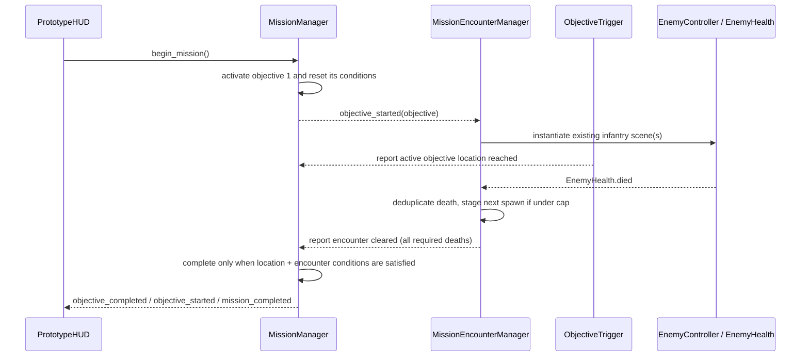

# Phase 4C — Mission 01 Combat Integration Architecture Plan

**Status: COMPLETE (2026-11-09).** This document records the design and implementation scope. Automated verification passed, and the project owner reports manual gameplay verification passed; see `PHASE_04C_TEST_REPORT.md`. No Phase 5 work is included.

## Goal and scope

Integrate the existing infantry combat AI into Mission 01 so objectives 1–4 require both reaching their location and defeating their assigned encounter. Objective 5 remains a final rally/extraction location. Keep the briefing, player, health/death/restart, weapons, HUD, mission completion flow, and the separate F6 Enemy Test Range. Do not put enemies into the scene before the player starts the mission.

The current mission is a low-poly graybox with five location-only objectives. Phase 4C should add a modest, staged combat layer to that route without rewriting the reusable enemy controller or turning the objective manager into a combat AI system.

## Existing architecture audit

| Area | Current implementation | Phase 4C implication |
|---|---|---|
| Project setup | `project.godot` uses Godot 4.7 / GL Compatibility, 1280×720, and autoloads `GameManager`, `SettingsManager`, and `MissionManager`. | Keep the renderer and autoload set. Do not make the encounter manager a global autoload. |
| Main scene | `scenes/main/main.tscn` owns lighting/environment, the scripted `Battlefield`, `Player`, and `HUD`. Battlefield geometry is constructed by `scripts/environment/battlefield.gd` in `_ready()`. | Put encounter ownership under the Mission 01 battlefield or a local child scene, not in the global manager. Preserve the main scene's existing player and HUD instances. |
| Route and objectives | The continuous ground is centered at `(0, -0.5, -25)`, size `(74, 1, 142)`, covering approximately `z=-96..46`. The visible road is centered at `z=-30`; building shells border it near `x=±17`. `mission_01.tres` places trigger centers at `z=14, -8, -42, -75, -90`. | Keep these objective anchors unless in-engine collision and encounter tests show a specific conflict. Enemies must not spawn inside the walls, lorry, low cover, trigger arches, player, or one another. |
| Trigger behavior | `ObjectiveTrigger` is a non-blocking `Area3D`, listens for `PlayerController`, and calls `MissionManager.complete_objective()` when the active trigger is entered. | This direct location-to-completion path must become a report of the location condition. It must not independently finish a combat objective. Continue to reject non-player bodies and duplicate reports. |
| Mission progression | `MissionManager` owns READY/ACTIVE/COMPLETED/FAILED state, ordered objective state, duplicate/out-of-order guards, and failure on `GameManager.player_died`. It emits `objective_started` and completion/failure signals. | Keep it the single authority for whether an objective is complete. Add explicit condition-reporting/gating; do not move enemy pathing, target selection, or firing into it. |
| Player and restart | `PlayerController` uses `CharacterBody3D`; `PlayerHealth` emits health/death and ignores damage after death. Death fails the active mission; the existing HUD offers restart and `GameManager` reloads the current scene. | Preserve this failure/reload path. Encounter cleanup must happen on mission failure and scene teardown, and a new scene must start with fresh encounter state. |
| Weapons | `WeaponManager` owns the Mosin and PPSH; `WeaponBase` uses camera-centered hitscan and calls `apply_damage(int)` on the first collider that implements it. Enemy health has the matching damage receiver. | Reuse both existing weapons and the existing `EnemyHealth` damage/death contract. Do not add a parallel player weapon or enemy damage interface. |
| Enemy actor and AI | `infantry_enemy.tscn` is a `CharacterBody3D` on collision layer 4 with capsule collision, `EnemyHealth`, `NavigationAgent3D`, primitive soldier meshes, and `AnimationPlayer`. `EnemyController` provides IDLE, INVESTIGATE, CHASE, ATTACK, RELOAD, and DEAD states; it finds `GameManager.current_player`, checks line of sight, attacks at range, and responds to death. Defaults include 22 m detection, 14 m attack, 30 m target loss, five rounds, and 12 damage per shot. | Instantiate the same scene. Track only enemies spawned by the active Mission 01 encounter. Avoid adding mission-specific behavior to `EnemyController`; its current AI and damage behavior remain reusable. |
| Navigation | NavigationRegion3D/NavigationMesh is constructed only in the enemy test range. Mission 01 currently has no navigation map. The enemy controller waits for a valid, synchronized navigation map before moving. | A Mission 01 navigation solution is a required dependency, not a tuning-only task. Validate that every spawn and the combat lane lie on a connected walkable map before enabling an encounter. |
| Test range | `enemy_test_range.tscn` owns the existing player, one enemy, a hand-authored navigation polygon, obstacles and a live state/health/ammo readout. It is separate from `main.tscn`. | Leave it unchanged. Its existing Phase 3B harness remains a regression gate. |
| HUD and briefing | `prototype_hud.gd` listens to mission/objective/health/weapon signals and already shows objective text, completion, death, and restart UI. Briefing pauses the tree; Start Mission begins the mission and captures the mouse. | Keep UI signal-driven. Existing panels should remain; objective names/descriptions can be revised to explain encounter requirements. Do not add per-frame encounter polling to the HUD. |

### Confirmed integration gaps

1. Mission 01 currently has no enemy instances and no navigation region. The F6 range proves the reusable enemy can navigate in its own small map; it does not prove that enemy pathfinding works on the Mission 01 route.
2. Objective 1–5 currently advance by entering their Area3D trigger. There is no kill requirement, encounter data, spawn lifecycle, or encounter-to-objective signal path.
3. An active objective emits `objective_started` synchronously. This is a suitable local event for starting an encounter, but the encounter manager must connect before the user presses Start Mission and must be idempotent.
4. `EnemyController` can stop attacking when the player dies, but it does not remove mission-owned enemy instances or reset encounter counters. Mission-local ownership and cleanup are needed.
5. Existing automated tests encode the location-only design. In particular, the Phase 4A test asserts Mission 01 contains no Phase 3B enemy, and the Phase 4B objective test advances by touching triggers. Those checks must be replaced with equivalent checks for “no spawn before Start Mission” and “combat plus location gate,” not deleted or weakened.

## Proposed architecture

Use a **mission-local `MissionEncounterManager`** beneath `Battlefield`. This is justified because four objectives need the same spawn, kill tracking, wave cap, cleanup, and duplicate-spawn behavior, while those behaviors are specific to the loaded mission. It is not an autoload and does not own global mission progression.

Keep responsibilities narrow:

- **`MissionManager`** owns mission/objective states and the completion gate. It records the current objective's required conditions and completes it once they are all satisfied.
- **`ObjectiveTrigger`** reports that the player reached its active objective location. It no longer completes an encounter objective merely because the player touched the trigger.
- **`MissionEncounterManager`** listens to `MissionManager.objective_started`, loads the encounter data for that objective, spawns the existing infantry scene, tracks those instances and their deaths, reports when the encounter is cleared, and cleans up on mission reset/failure/completion.
- **`EncounterDefinition`** is data: stable encounter ID, spawn positions relative to Battlefield, and maximum simultaneous enemies. It does not contain duplicated enemy AI or weapon behavior.
- **`ObjectiveDefinition`** references an optional `EncounterDefinition`. An objective with an encounter requires both its location condition and its encounter-cleared condition. An objective without an encounter requires only its location condition.
- **`EnemyController` / `EnemyHealth`** remain unchanged in responsibility. The manager connects to the spawned actor's existing `EnemyHealth.died` signal; it does not poll health every frame or teach the enemy about mission objective IDs.
- **`PrototypeHUD`** continues to display objective state from MissionManager signals. No enemy scene references or per-frame polling are added to the HUD.

Recommended completion API shape (names are illustrative until implementation):

1. `ObjectiveTrigger` calls `MissionManager.report_objective_location(objective_id)` after validating `PlayerController` and the active objective.
2. `MissionEncounterManager` calls `MissionManager.report_objective_encounter_cleared(objective_id, encounter_run_id)` only after every required enemy in that active encounter has died.
3. MissionManager validates mission/objective state and the active run, deduplicates each report, then checks the objective's requirements. Only its internal completion transition advances the sequence and emits existing signals.
4. The public completion path must not let another caller bypass unsatisfied requirements. Preserve the existing return-value/duplicate behavior where possible and update tests to check the new gate.

Use stable objective and encounter IDs rather than node names as cross-system identity. Use a monotonically increasing run token or an equivalent local generation guard so a late death callback from a cleared/restarted encounter cannot advance the new run. Keep per-enemy instance IDs in a set to count each death exactly once.

## Mission encounter design

All coordinates below are **candidate Battlefield-local positions**, grounded against the existing route and obstruction layout. They require collision, sightline, and navigation verification in Godot before being accepted. The map is built from boxes at runtime, so source-coordinate inspection alone cannot establish safe final spawn points.

| Objective | Existing trigger center | Proposed threat and candidate spawn positions | Required completion |
|---|---:|---|---|
| 1 — Secure the Landing | `(0, 0, 14)` | One visible introductory infantryman at `(3, 0, 4)`. It is roughly 18 m from the initial player spawn `(0, 0.08, 22)`: inside the current detection range but initially outside the 14 m attack range. Activate it only after Start Mission. | Enter the landing trigger **and** defeat the one registered enemy. |
| 2 — Clear the Battlefield | `(0, 0, -8)` | Two infantrymen, initially staged around `(-3, 0, -17)` and `(3, 0, -20)`. This is a small pair, not a large wave. | Enter the transition trigger **and** defeat both registered enemies. |
| 3 — Advance Through the Street | `(0, 0, -42)` | Two infantrymen around `(3, 0, -50)` and `(-3, 0, -54)`. These candidate positions stay away from the lorry near `(-6.7, 0, -46)`; verify nearby rubble and timber cover before finalizing. | Enter the street trigger **and** defeat both registered enemies. |
| 4 — Secure the Position | `(0, 0, -75)` | Three total threats, but at most two alive/spawned simultaneously. Initial pair around `(-3, 0, -67)` and `(3, 0, -71)`; spawn the third at `(0, 0, -74)` after one of the first pair dies. This adds pressure through pacing rather than a larger simultaneous crowd. | Enter the position trigger **and** defeat all three registered enemies, including the reinforcement. |
| 5 — Complete the Mission | `(0, 0, -90)` | No new enemy. Keep the existing final rally/extraction marker as the clear completion action. | Reach the final trigger after objectives 1–4 have completed. The existing completion screen appears only after this fifth condition. |

This proposes eight total enemy spawns across the mission and a maximum of two live actors at once. The current enemy controller has no surrender/disable mechanic; for Phase 4C, “neutralize” should mean defeat through the existing health/death system. Do not implement nonlethal takedowns as part of this phase.

Candidate objective copy should clearly communicate the paired conditions, for example “Reach the landing and eliminate the enemy threat.” Keep final wording short enough for the current HUD and briefing layout. Preserve the distinction in the briefing between historical context and fictional orders.

## Navigation and placement design

Add a mission-specific connected navigation surface before spawning any enemies. Avoid a runtime full-environment bake as the default: `Battlefield` creates many primitives procedurally at scene startup, so a bake can add load-time cost and make results dependent on generated scene details.

Preferred first implementation: build one hand-authored `NavigationRegion3D` / `NavigationMesh` corridor for the unobstructed center of the existing street, with connected polygon coverage from the landing through the final trigger. The open road is 10 m wide; the current side barricades encroach toward the center near `x≈±4.9`. A candidate navigable strip around `x=-4..4`, `z≈44..-94` gives the current proposed spawns room while keeping the enemy's 0.4 m agent radius clear of those cover edges. Keep the strip inside the existing continuous ground. Exclude building shells, lorry, pier, crates, and solid cover from walkable polygons. Confirm exact polygon connectivity and clearance in Godot; do not assume NavigationObstacle3D avoidance can replace a valid path around static blockers.

The existing enemy's local avoidance can handle actor-to-actor spacing with the proposed two-live-enemy cap. It is not a replacement for the static walkable map. Set target/agent distances consistently with the current 0.8 m stopping distance, and verify that the controller does not remain idle because a spawn or player target is outside the navigation map. If the simple corridor cannot provide reliable navigation, stop and revise the navigation plan before adding encounter content rather than compensating with per-enemy pathing hacks.

## Objective completion and progression

Represent each active objective's requirements explicitly and reset them whenever a mission is prepared:

- Location reached: false until the active `ObjectiveTrigger` receives the player.
- Encounter cleared: false when the objective references an encounter; true/not required for a location-only objective.
- Per-condition reports: accepted once for the active objective and active mission run only.

An objective completes only when all required conditions are true. Either order is valid: the player may reach the trigger before the encounter is cleared, or defeat the last enemy before entering the trigger. A later trigger cannot satisfy the active objective's location condition. A kill from an enemy in the test range or from a stale prior encounter cannot count.

For encounter objectives, require all enemies in that encounter's spawn list to die. This avoids leftover live enemies when the objective advances and avoids ambiguous kill quotas. The encounter manager should mark the encounter clear only after the spawn queue is empty and every registered enemy has emitted `EnemyHealth.died`. The final objective has no encounter and retains the existing location-only completion behavior.

## Signal flow

On objectives without an encounter, the location report satisfies all required conditions and progression remains immediate. Preserve current HUD signal ownership and current mission completion/failure signals.

## Enemy spawn lifecycle, leave behavior, and duplicate protection

1. Mission scene initializes geometry, navigation and the local encounter manager while the briefing is shown. The manager connects to mission lifecycle signals but spawns nothing in READY state.
2. Start Mission activates objective 1. The manager verifies a valid, synchronized navigation map and valid encounter data before instantiating the assigned scene.
3. Spawn actors as children owned by the local encounter manager. Apply Battlefield-local transforms after adding them to the tree. Track the active objective ID, run token, every spawned actor ID, living count, spawn queue and confirmed deaths.
4. Connect each `EnemyHealth.died` once. On death, ignore callbacks for unknown IDs, already-counted IDs, a different objective, a cleared run, or a non-active mission. Schedule the next reinforcement only if the active encounter has queued enemies and is below its cap.
5. If the player leaves an encounter area, do not auto-complete, despawn, respawn, or count survivors as defeated. The current enemy AI may investigate the last known position and return to IDLE after its existing timeout/range rules. The objective remains active; the player can re-engage and return to the location trigger. Confirm that the enemies remain on the Mission 01 navigation map during this case.
6. Once all encounter enemies are defeated and the location condition is also satisfied, report encounter clear once. When MissionManager advances, clear remaining corpse nodes from the prior encounter after the existing death placeholder has had a short presentation window; do not keep old encounter bodies active.
7. On mission failure, mission completion, preparation of a new run, or scene teardown, clear the pending spawn queue, invalidate the run token, stop/disable tracked actors, disconnect local callbacks as needed, and free mission-owned enemies. Scene reload remains the authoritative full reset.

No enemy spawn signal should be connected globally. Local node ownership should ensure all encounter nodes are freed when Mission 01 reloads, even if an unexpected teardown occurs.

## Player death and restart handling

Retain the current lifecycle: `PlayerHealth.died` → `PlayerController` death handler → `GameManager.player_died` → `MissionManager` fails the active objective/mission → existing HUD death panel and restart action. The encounter manager listens to `mission_failed` and clears the active encounter immediately so no dead player continues receiving attacks or accumulating callbacks. `GameManager.restart_current_scene()` reloads Mission 01; the new scene prepares the mission, shows the briefing, and has no old encounter state. Verify full health, objective 1 READY state, fresh enemy IDs, and exactly one first encounter after the next Start Mission click.

Mission completion continues through the existing final objective signal into the existing completion panel. It must not be emitted when the last enemy dies if the location condition has not been met, nor when the player reaches a combat trigger while enemies remain alive.

## Expected implementation file changes (after approval)

### Existing gameplay files likely to change

- `resources/missions/mission_01.tres` — revise objective names/descriptions and attach encounter data to objectives 1–4; leave objective 5 as final location condition.
- `scripts/missions/objective_definition.gd` — add optional typed encounter data.
- `scripts/missions/mission_manager.gd` — store/reset objective conditions and gate completion until required reports arrive; retain order, failure and duplicate guards.
- `scripts/missions/objective_trigger.gd` — report location reached instead of completing combat objectives directly.
- `scripts/environment/battlefield.gd` and `scenes/main/main.tscn` — provide the Mission 01 navigation corridor and local encounter manager under the battlefield; preserve all current environment, player, HUD and light nodes.
- `scripts/ui/prototype_hud.gd` — only if new objective text/encounter-clear feedback cannot be expressed through the existing objective signals. Prefer updating mission resource text without adding a second HUD update path.

### New gameplay/data files likely to be added

- `scripts/missions/encounter_definition.gd` — reusable encounter data type.
- `resources/missions/encounters/landing_encounter.tres`
- `resources/missions/encounters/transition_encounter.tres`
- `resources/missions/encounters/street_encounter.tres`
- `resources/missions/encounters/position_encounter.tres`
- `scripts/missions/mission_encounter_manager.gd` — Mission 01-local encounter lifecycle/spawn/death tracking.
- A navigation resource/scene only if a script-built hand-authored `NavigationMesh` proves awkward to maintain; do not add both a duplicate resource and duplicate navigation logic.

### Test and report files expected to change/add

- Update `scripts/testing/phase_04a_runtime_check.gd`: replace “Mission 01 remains free of enemies” with an equivalent assertion that no encounter is spawned before the briefing is started; keep the environment traversal assertion isolated from combat, or add a separate traversal setup that does not weaken combat checks.
- Update `scripts/testing/phase_04b_runtime_check.gd`: keep its briefing/HUD/restart coverage, and exercise the new paired conditions with real registered encounter enemies rather than allowing location-only completion.
- Add `scripts/testing/phase_04c_runtime_check.gd` and `scenes/testing/phase_04c_runtime_check.tscn` for combat-specific lifecycle and gating assertions.
- Update `scenes/testing/phase_04a_runtime_check.tscn` and `scenes/testing/phase_04b_runtime_check.tscn` only if their harness setup needs an explicit non-combat/test fixture; retain their existing coverage.
- Add `docs/PHASE_04C_IMPLEMENTATION_REPORT.md` and `docs/PHASE_04C_TEST_REPORT.md` after implementation and actual validation.
- Update `docs/PROJECT_ARCHITECTURE.md`, `docs/MISSION_01_CURRENT_STATUS.md`, `docs/PHASE_04A_TEST_REPORT.md`, and `docs/PHASE_04B_TEST_REPORT.md` only where the now-current combat integration changes their descriptions or test status. Do not rewrite historical owner-reported results.

The implementation set was narrowed and completed under the owner's Phase 4C authorization. See `PHASE_04C_IMPLEMENTATION_REPORT.md` for the actual files and implementation decisions.

## Performance considerations

- Target a maximum of two live enemies at once. The proposed eight total threats are spawned across sequential objectives, with Objective 4 staging its third enemy after a death.
- Reuse the one lightweight primitive enemy scene and its existing materials. Do not add new character assets, dynamic shadows, particles, or per-enemy UI.
- Keep the current distance/LOS polling cadence and shot cadence initially. With two enemies, detection checks remain bounded; profile before changing intervals.
- Use one connected mission corridor and local actor avoidance, not a dense navigation mesh per encounter. Avoid repeated navmesh baking, rebuilding, or allocations during combat.
- Do not poll every enemy every frame from the encounter manager. Use death signals and bounded spawn bookkeeping.
- Test worst-case two-enemy line of sight, firing, reload and death on Intel UHD 620. Do not promise an FPS target without measured results.

## Risks and mitigations

| Risk | Mitigation / gate |
|---|---|
| Missing/disconnected Mission 01 nav data leaves spawned enemies idle | Validate synchronized navigation map, all spawn projections, route connectivity, movement and boundary cases before combat tests. |
| Spawn overlaps a cover prop, trigger, player, or another enemy | Add runtime/editor collision-clearance checks; inspect every proposed point in the actual rendered scene and adjust data before tuning AI. |
| Enemies attack before player has control | Spawn only after Start Mission; place the first threat outside attack range at initial spawn; verify LOS and time-to-first-hit in manual play. |
| Trigger traversal accidentally completes an objective | MissionManager is the only completion authority and verifies every declared condition; add tests for location-only, kills-only, both orders, duplicates and future triggers. |
| Duplicate or stale death events advance the wrong objective | Use per-instance death deduplication plus a per-run token and active objective ID check. |
| Player death leaves active enemies/timers behind | Clear the local encounter on `mission_failed`; test death at each combat objective and restart from the briefing. |
| Player leaves the encounter and enemies become unreachable/off-map | Keep objectives active, rely on current investigate/lose-target behavior, test leaving/re-entry, and enforce a tested route leash only if necessary. |
| Existing Phase 4A/4B tests fail because they assume no enemies/location-only objectives | Replace outdated assertions with equivalent stronger combat-aware assertions; keep historical reports explicit about what each version tested. |
| Too much simultaneous AI or scene startup cost | Cap active enemies at two, spawn only the active objective's group, use static navigation data, and profile on target hardware. |
| Test-range behavior regresses through shared enemy changes | Prefer no EnemyController changes; run the existing Phase 3B 26-check harness after each integration stage and test F6 manually. |

## Step-by-step implementation stages

1. **Pre-change baseline:** preserve the current Phase 3B, 4A, and 4B results; identify assertions that become stale. Record the project version and existing uncommitted changes. No implementation starts without approval.
2. **Data and completion gate:** define EncounterDefinition and optional encounter data; add objective location/encounter condition state and reset/dedup logic in MissionManager; change ObjectiveTrigger to report location. Add deterministic checks that neither condition alone can complete a combat objective.
3. **Mission navigation:** author the central connected corridor, attach it to Mission 01, verify map synchronization, spawn projection and clearance for every candidate position, and measure whether any runtime bake is needed. Do not proceed with enemy placement until navigation is reliable.
4. **Local encounter manager:** connect objective lifecycle, spawn the existing enemy scene after objective activation, track health death signals, stage reinforcement under the cap, report encounter clear once, and clean up on fail/restart/completion.
5. **Mission content:** add encounters and candidate spawn positions for objectives 1–4; update objective text; preserve the final objective marker and existing briefing/completion/restart panels.
6. **Regression harnesses:** add Phase 4C checks and adapt Phase 4A/4B checks to the new intended behavior without removing assertions or weakening their equivalent coverage. Run Phases 4C, 4B, 4A, and 3B after integration.
7. **Manual acceptance and docs:** run F5 and manually play each encounter, both weapons, player death/restart, final 5/5 completion, and F6 range. Inspect actual non-headless rendered captures separately from headless results. Record warnings, failures, hardware, and untested performance/export items in the Phase 4C reports.

## Test strategy

### Automated checks

- Godot 4.7.2 project import/class registration and resource-reference scan.
- Main scene and Mission 01 startup with no encounter spawned during READY briefing; one correct encounter after Start Mission.
- Each encounter's expected spawn count, actor ownership, collision-clear positions, nav map readiness, spawn cap, and no duplicate spawn on repeated lifecycle signals.
- Enemy health death signal counted once; unrelated/test-range/stale-run enemy death does not count.
- For each objective, verify location-only is insufficient when enemies remain, kill-only is insufficient before location, both event orders succeed once, and out-of-order locations cannot skip the active objective.
- Enemy detection, approach, attack/player damage, LOS obstruction, reload, death, and player weapon hitscan kill using existing receiver. Use bounded waits or explicit health damage for deterministic condition bookkeeping, while retaining at least one end-to-end real weapon-hit test.
- Player death during each encounter fails the mission, stops/clears mission-owned attacks and actors, and restart shows the briefing with fresh state and exactly one new first encounter.
- Complete objectives 1–5; completion panel appears only after objective 5 and reports 5/5.
- Existing Phase 3B 26-check test range, Phase 4A environment checks, Phase 4B briefing/weapon/HUD/restart checks, and player-health regressions.
- Capture and distinguish parser/runtime errors from known Windows certificate-store, editor-settings and user-log environment warnings.

### Manual checks

- Run Godot 4.7.2 on the target Compatibility renderer, F5 into briefing, and verify no enemies are active or firing before Start Mission.
- Start the mission; visually inspect all candidate spawn points, player sightlines, trigger markers, route cover and enemy ground placement.
- Fight each encounter while moving through the map. Confirm enemies detect, chase around/through the intended route, stop at combat range, respect blocked LOS, fire, reload, and can be killed by Mosin and PPSH.
- Leave and re-enter an active encounter; ensure surviving enemies remain reachable and objective progress does not advance early.
- Die during combat, use the existing restart action, and confirm no old enemy, callback, health value or objective progress survives the reload.
- Finish all four encounters and the fifth rally objective; verify the existing completion screen appears at 5/5 and restart returns to a clean briefing.
- F6 the Enemy Test Range after Mission 01 combat changes; confirm its current scene, AI, UI and combat still work.
- Watch Godot's debugger/output during these checks. Report actual findings; do not claim visual verification from headless runs.

## Acceptance criteria

- Mission 01 has no active enemies before Start Mission and no enemies are added to any other scene.
- Objectives 1–4 each require their active location condition and defeat of all enemies assigned to that encounter; Objective 5 requires reaching the final marker after earlier objectives.
- Neither trigger entry alone nor enemy deaths alone can prematurely advance a combat objective. Out-of-order visits and duplicate/stale deaths are ignored.
- Each objective spawns only once per mission run. Objective 4 never exceeds two live enemies. Spawned enemies use existing health, AI, collision, weapons and visuals.
- Enemies have a valid connected navigation path through the Mission 01 route, spawn on clear ground, detect/chase/attack, respect line of sight and can be killed with both existing weapons.
- Player death fails the mission and clears/stops encounter actors; existing restart resets player/mission/encounter state and shows the briefing.
- The five objectives complete in sequence; existing HUD updates; mission completion and 5/5 screen appear only after objective 5.
- Mission 01's F5 scene retains its existing player, weapons, HUD, environment and lighting; the F6 Enemy Test Range remains functional and isolated.
- All specified automated regressions pass. Manual rendered/input checks and performance results are reported as such, not inferred from headless tests.
- No Phase 5 work began in this phase. Phase 4C is marked complete based on the automated results and owner-reported manual gameplay verification recorded in the reports.
